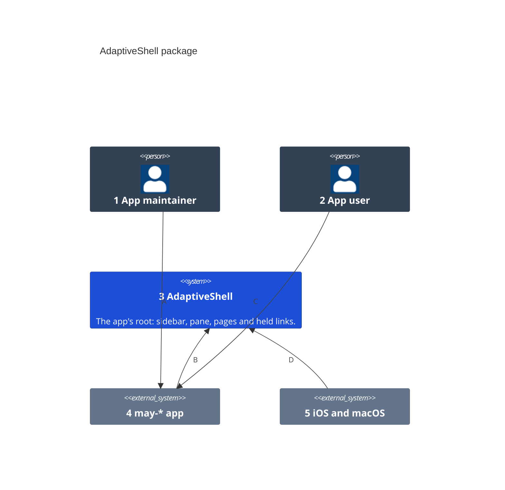
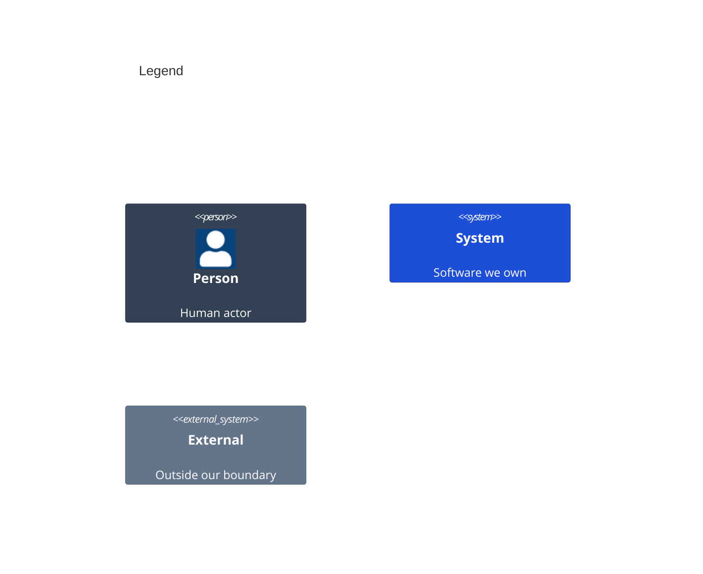

# System Context

Who uses the AdaptiveShell package and what it talks to.

Numbers on nodes and letters on arrows match the callout table.

| #   | Description | Why |
| --- | --- | --- |
| 1   | The developer who adds the shell to a may-* app. | They hand it the path and the views. |
| 2   | A person using the app on a phone, an iPad or the Mac. | The layout follows their screen. |
| 3   | The shell, lifted from may-photos. | The root is written once for every app. |
| 4   | An app that draws its root with the shell. | It owns its pages and words. |
| 5   | Gives the size class, the window's width and opened links. | The shell lays out from them. |
| A   | Builds the root with the shell and a pending open. | One view and one modifier adopt it. |
| B   | Hands over its path, sidebar, pane, pages and link reader. | The routes stay the app's own. |
| C   | Opens pages and taps links. | Pages land where the screen has room. |
| D   | Reports the screen's width and the links it opens. | A narrow split moves the sidebar aside. |
