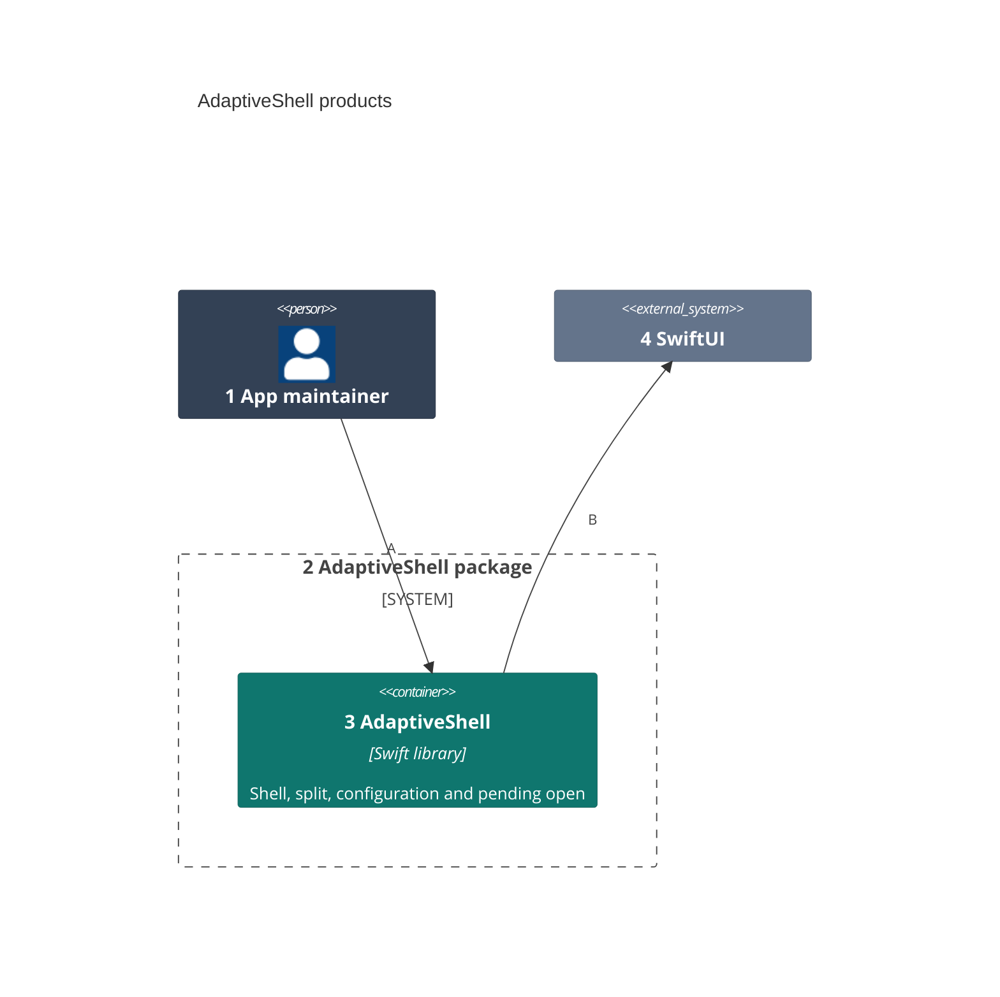
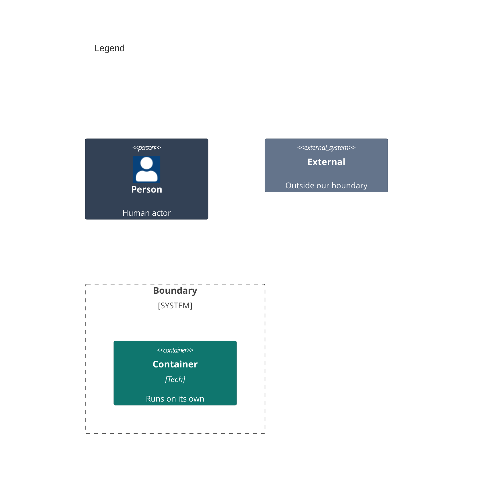

# Containers

The package runs inside the host app's process; its one product is the container an app links.

Numbers on nodes and letters on arrows match the callout table.

| #   | Description | Why |
| --- | --- | --- |
| 1   | The maintainer who adds the shell to an app. | They link the product. |
| 2   | `Packages/AdaptiveShell`, with its own manifest. | It builds and tests alone. |
| 3   | The one library an app links for its root. | It needs nothing beyond SwiftUI. |
| 4   | Apple's stacks, split view and toolbars. | The shell arranges them. |
| A   | Links the library and builds its root with it. | No other setup. |
| B   | Draws a stack or a split with the rail's toggle. | The system draws each platform's chrome. |
