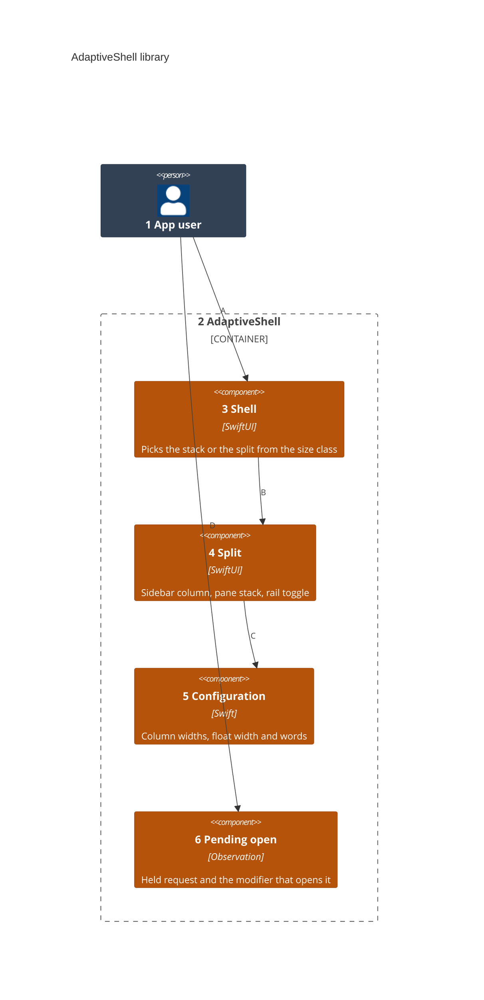
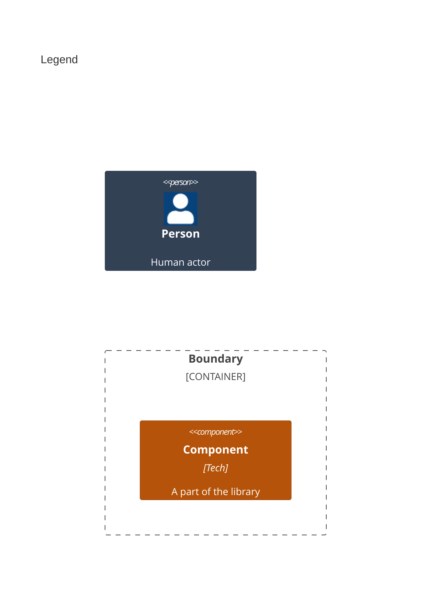

# Components

This splits the AdaptiveShell library in [02-containers.md](02-containers.md) into its parts.

Numbers on nodes and letters on arrows match the callout table.

| #   | Description | Why |
| --- | --- | --- |
| 1   | The person using the app. | They open pages and links. |
| 2   | The AdaptiveShell library. | One product holds every part. |
| 3   | `AdaptiveShell` and `ShellLayout`. | A compact width stacks; any other splits. |
| 4   | `ShellSplit`, which a Mac-only app may use alone. | The wide layout keeps the pane's own stack. |
| 5   | `ShellConfiguration` and `ShellWords`. | A host matches its sizes and catalog. |
| 6   | `PendingOpen` and `opensRequests(_:perform:)`. | A cold launch's link waits for its screen. |
| A   | Opens a page from the sidebar. | The page lands where the screen has room. |
| B   | Hands the wide layout its views and path. | Both layouts share one path. |
| C   | Reads the widths and the toggle's words. | Defaults need no setup. |
| D   | Taps a link that launches the app. | The request opens once the screen shows. |
