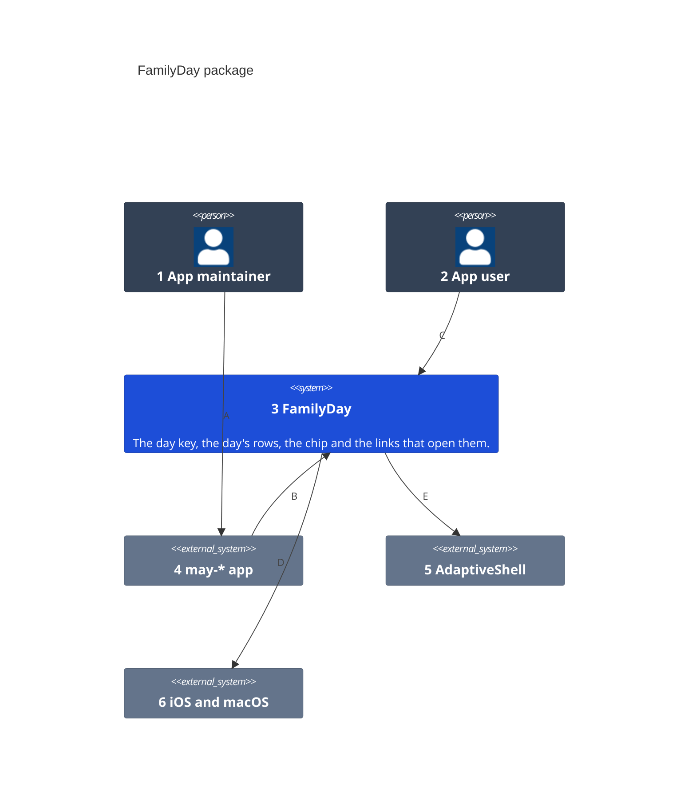
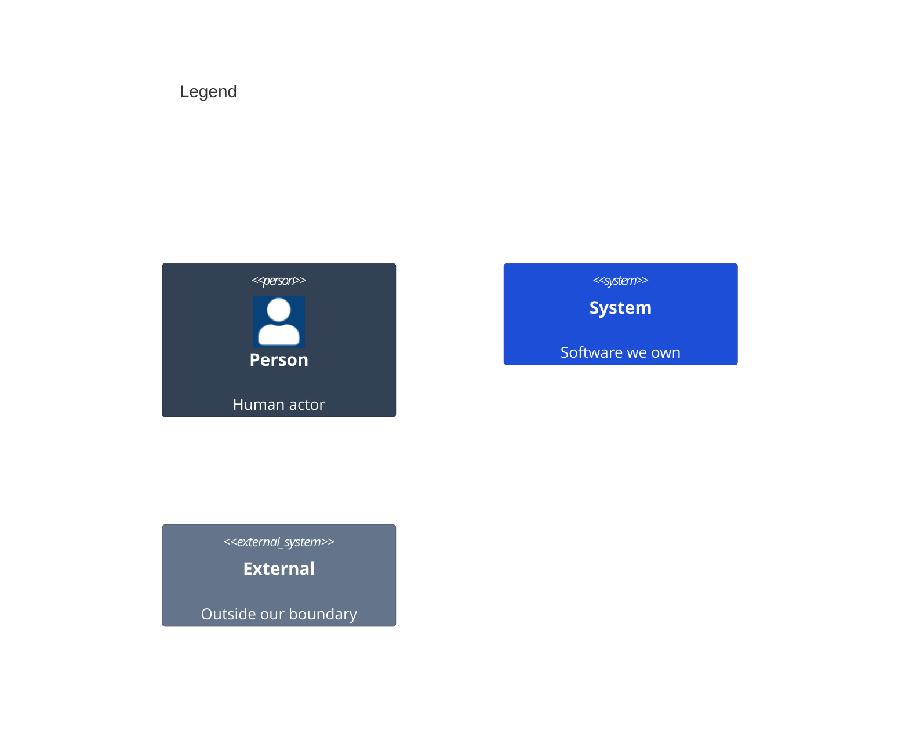

# System Context

Who uses the FamilyDay package and what it talks to.

Numbers on nodes and letters on arrows match the callout table.

| #   | Description | Why |
| --- | --- | --- |
| 1   | The developer who adds a day's row or chip to a may-* app. | They key what the app holds by day. |
| 2   | A person who sees their day across the family's apps. | One tap opens the app that made a row. |
| 3   | The package, keyed as Captions keys its day line. | Every app agrees on one day. |
| 4   | An app that writes a row, shows the chip or opens a day. | It owns what it holds that day. |
| 5   | The shell whose `PendingOpen` holds a link until the screen shows. | A day opens on a cold launch too. |
| 6   | Routes each link to the app that answers its scheme. | The apps never call each other. |
| A   | Keys its items by day and draws rows and the chip. | A few values and two views adopt it. |
| B   | Hands over each row's sender, title, kicker and item. | The words stay the app's own. |
| C   | Taps a row or the chip. | The tap opens the app at that day. |
| D   | Opens the row's or the chip's link. | The system finds the app. |
| E   | Reads each heard link into a day link for one app. | Another app's link opens nothing. |
