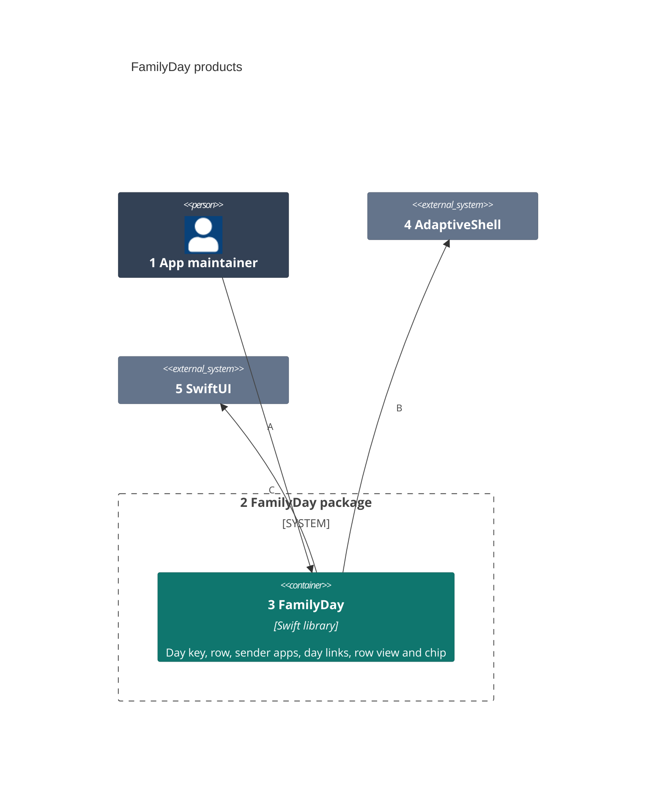
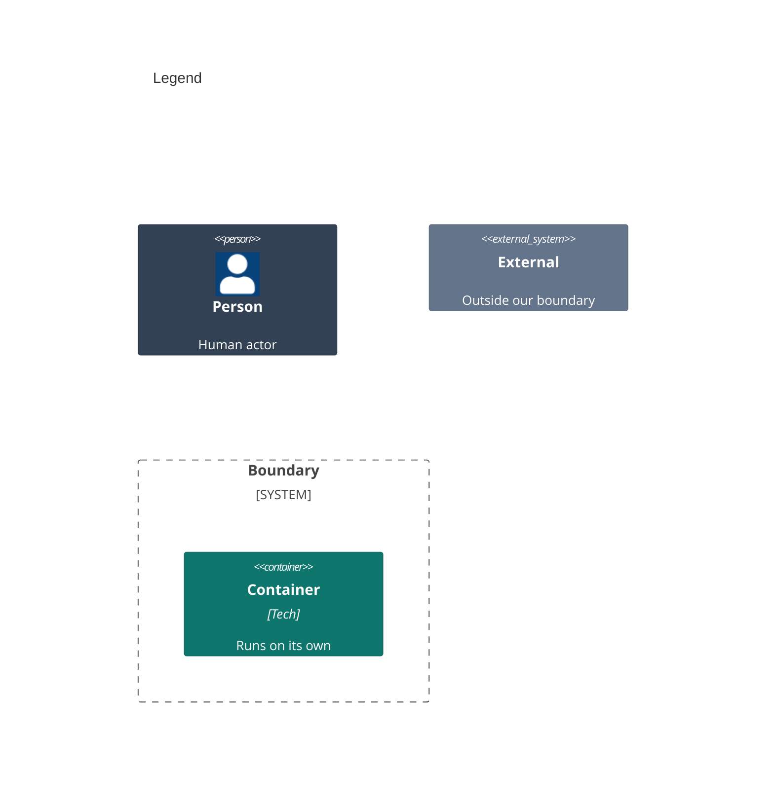

# Containers

The package runs inside the host app's process; its one product is the container an app links.

Numbers on nodes and letters on arrows match the callout table.

| #   | Description | Why |
| --- | --- | --- |
| 1   | The maintainer who adds a day to an app. | They link the product. |
| 2   | `Packages/FamilyDay`, with its own manifest. | It builds and tests alone. |
| 3   | The one library an app links for its day. | Every app shares one key and one row. |
| 4   | The package whose `PendingOpen` holds a day link. | Links open the way they already do. |
| 5   | Apple's buttons, labels and `openURL`. | The system routes each link. |
| A   | Links the library and writes its rows with it. | No other setup. |
| B   | Reads day links into the shell's pending open. | A cold launch's day waits for its screen. |
| C   | Draws the row and the chip, and opens their links. | A host or a test can route the links. |
