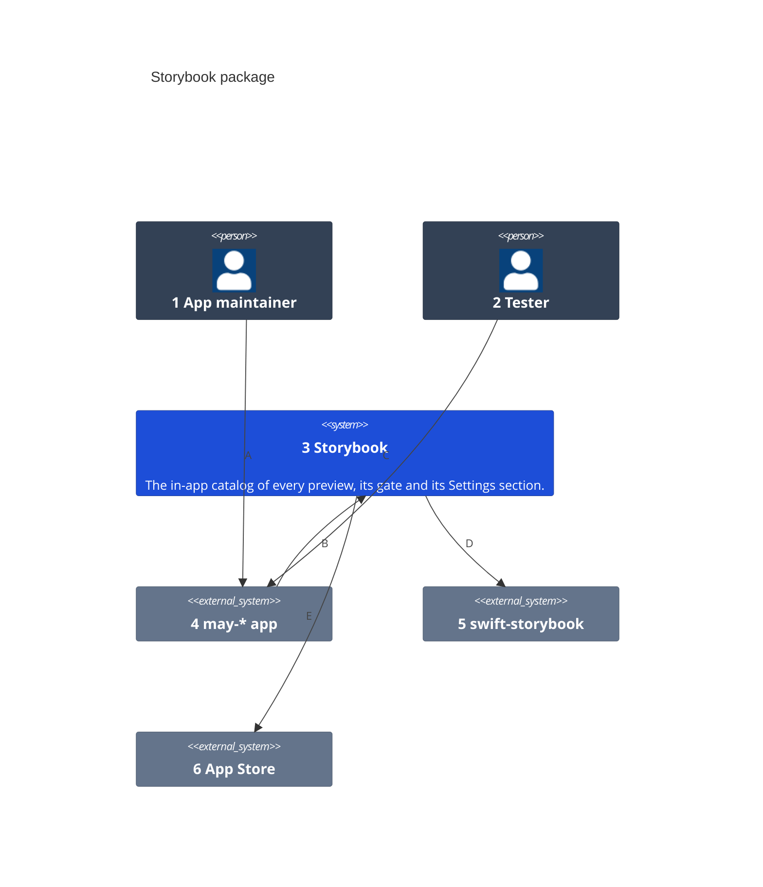
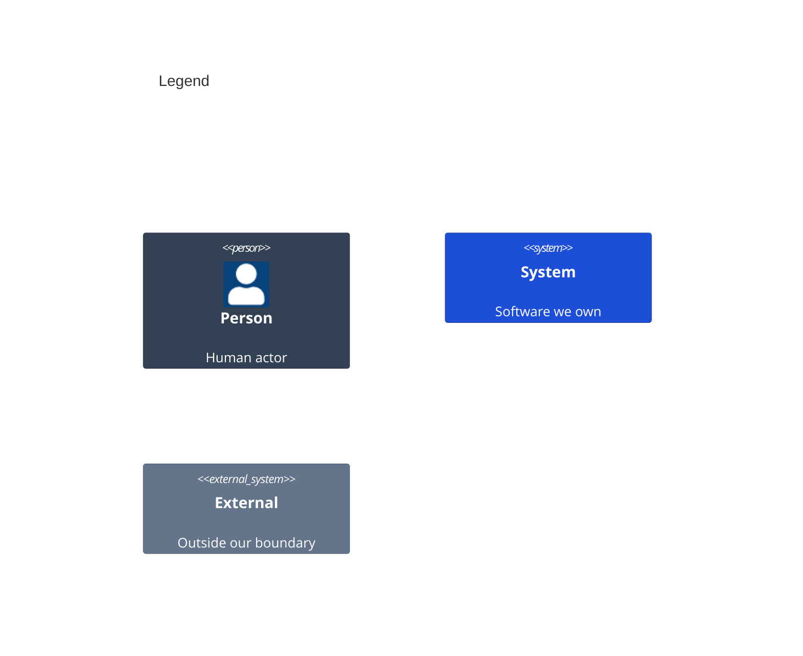

# System Context

Who uses the Storybook package and what it talks to.

Numbers on nodes and letters on arrows match the callout table.

| #   | Description | Why |
| --- | --- | --- |
| 1   | The developer who adds Storybook to a may-* app. | They add the package and choose its gate. |
| 2   | A person who checks a TestFlight or Debug build. | They open the catalog to see every state. |
| 3   | This package. | The catalog is written once for every app. |
| 4   | The app that links the package. | It holds one availability object. |
| 5   | eure's library that finds every `#Preview`. | The catalog lists what it finds. |
| 6   | Says whether a build came from TestFlight or the App Store. | Only the sandbox gate asks it. |
| A   | Adds the entry, the Settings section and pages of its own. | One modifier and one view adopt it. |
| B   | Hands over its gate, labels, version and pages. | The host owns its words. |
| C   | Taps Version, the Storybook row, or shakes the phone. | Each way opens one cover. |
| D   | Scans the binary for previews. | No list of previews to keep. |
| E   | Asks once which build this is. | App Review sees the sandbox too. |
