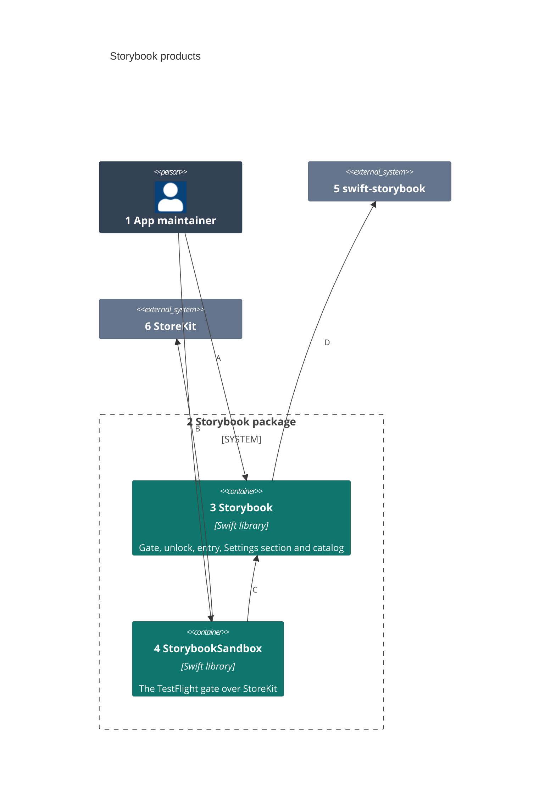
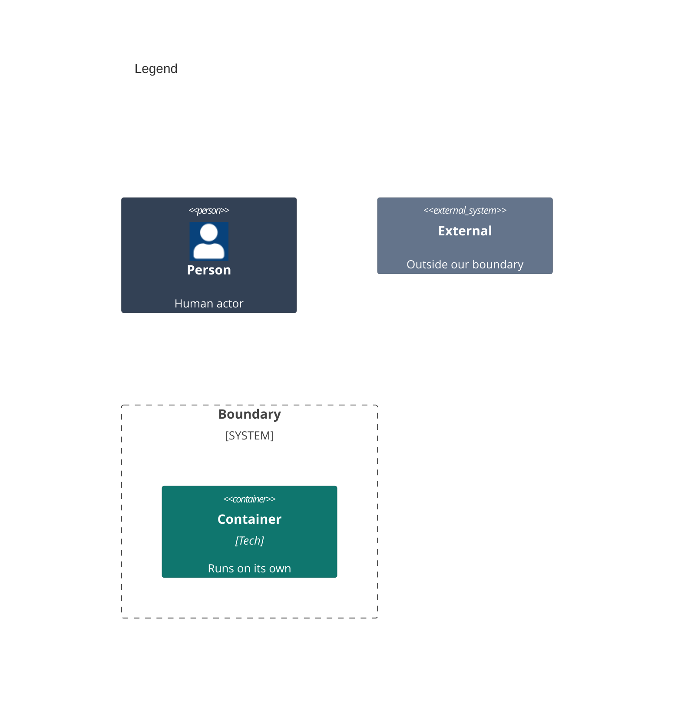

# Containers

The package runs inside the host app's process; its two products are the containers an app links.

Numbers on nodes and letters on arrows match the callout table.

| #   | Description | Why |
| --- | --- | --- |
| 1   | The app maintainer from the system context. | They pick the products to link. |
| 2   | `Packages/Storybook`, with its own manifest. | It builds and tests alone. |
| 3   | The library every adopting app links. | It never imports StoreKit. |
| 4   | The library that adds `.debugOrSandbox`. | Only an app that wants the TestFlight rule links StoreKit. |
| 5   | eure's preview finder and page types. | The catalog builds on it. |
| 6   | Apple's framework that reads the App Store's signature. | It answers which build this is. |
| A   | Links the library and injects `.debugOnly` or its own gate. | The default never ships the catalog. |
| B   | Links the sandbox library for TestFlight builds. | The choice is explicit. |
| C   | Builds a gate the core library accepts. | One gate type for every rule. |
| D   | Reads every `#Preview` and launch request. | The parsing lives upstream. |
| E   | Asks for the app transaction's environment. | A thrown answer is asked again. |
