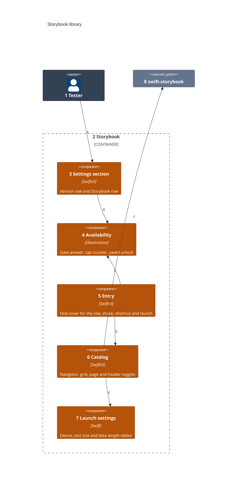
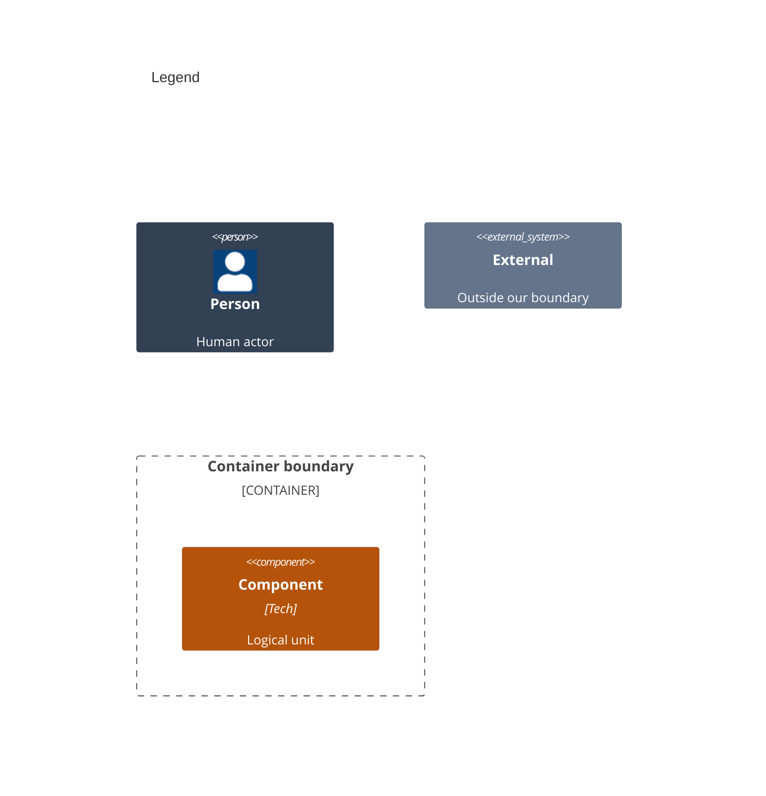

# Components

This splits the Storybook library in [02-containers.md](02-containers.md) into its parts.

Numbers on nodes and letters on arrows match the callout table.

| #   | Description | Why |
| --- | --- | --- |
| 1   | The tester from the system context. | They reach the catalog through Settings. |
| 2   | The library an app links. | Every part ships together. |
| 3   | `StorybookSettingsSection`, the one view an app drops into its Form. | Version and Storybook rows stay in step. |
| 4   | `StorybookAvailability`, which the app holds one of. | The row and the cover read one state. |
| 5   | `storybookEntry(_:)` at the app's root. | Two covers can never stack. |
| 6   | The split-view catalog over every page. | Testers browse every state. |
| 7   | The settings each `--storybook-*` argument and header button sets. | A capture can be repeated. |
| 8   | eure's preview finder. | Pages come from `#Preview` blocks. |
| A   | Taps Version seven times, then Storybook. | The switch is hidden from App Review. |
| B   | Counts the taps and reads whether the catalog may open. | The gate decides the build. |
| C   | Waits on the gate's answer, then opens the cover. | No way in reads a stale answer. |
| D   | Shows the catalog, opened at the page a launch named. | Every way in shows the same catalog. |
| E   | Reads the launch arguments once per launch. | A header tap is not undone on redraw. |
| F   | Lists every preview and the app's own pages. | The app keeps no list of previews. |
