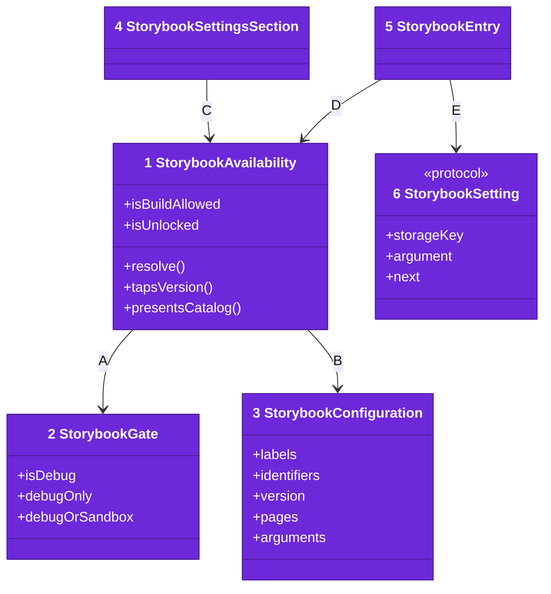
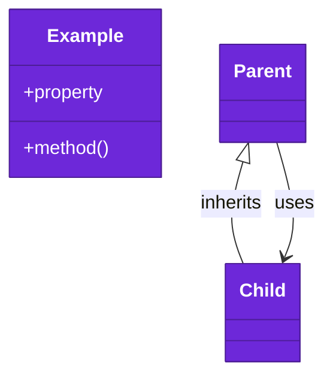

# Code

The types an app meets, from [03-components.md](03-components.md).

Numbers on classes and letters on relationships match the callout table.

| #   | Description | Why |
| --- | --- | --- |
| 1   | The state machine: build answer, seven-tap counter, unlock saved in user defaults. | One object per app. |
| 2   | Who may see the catalog, injected by the app. | `.debugOnly` is the safe default. |
| 3   | The host's words, accessibility IDs, version, pages and launch arguments. | The package hardcodes no app. |
| 4   | The version row and the Storybook row. | An app drops in one view. |
| 5   | The modifier holding the one cover, the shake and ⌥⌘⇧D. | Every way in meets here. |
| 6   | A header choice saved per launch, such as the device frame. | Arguments and buttons set one value. |
| A   | Asks the gate once, again after a failed answer. | Offline launches recover. |
| B   | Reads the host's configuration. | Labels come from the host. |
| C   | Shows the rows the availability allows. | The row and the cover agree. |
| D   | Opens the cover when the availability says so. | No second cover. |
| E   | Applies each `--storybook-*` argument once. | Header taps hold after redraws. |

## Tests

`swift test` in this folder runs one test per acceptance of requirements 0006, 0007 and 0008. Each renders a small diary app with the package, as an app does, and the App Store's answer is replayed.
