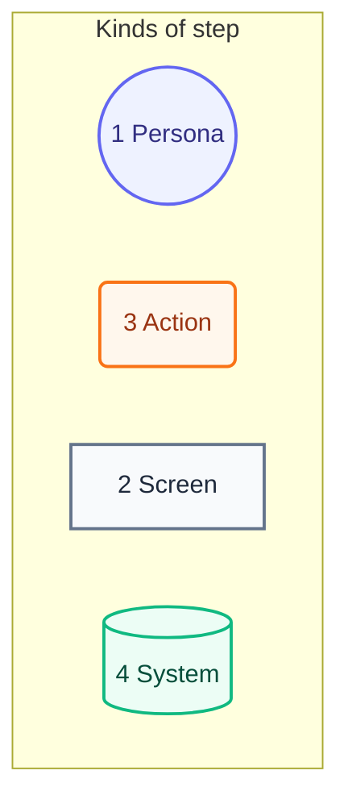
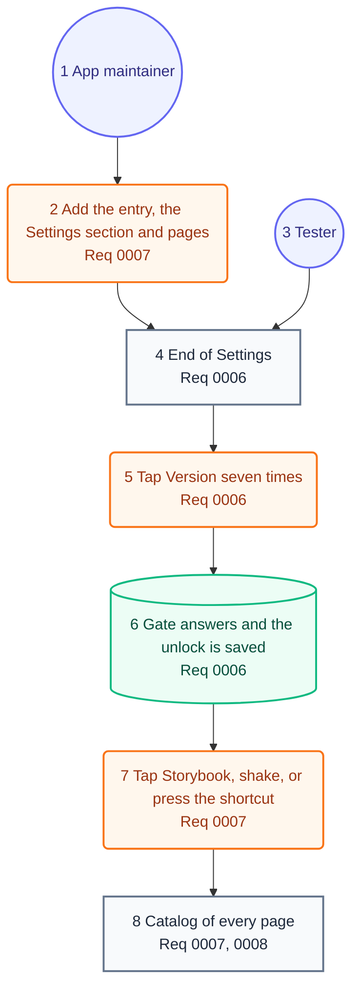

# User Journey

## Legend

Numbers match the callout table.

| #   | Description | Why |
| --- | --- | --- |
| 1   | A persona node. | Someone this package's system context names. |
| 2   | A screen node. | What the tester or maintainer looks at. |
| 3   | An action node. | A tap, click, shake or line of code. |
| 4   | A system node. | What the package does in reply. |

## Journey

Numbers match the callout table. The requirement docs live in the repo's root `docs/requirements`, where Fitness reads them.

| #   | Description | Type | Why |
| --- | --- | --- | --- |
| 1   | The app maintainer, wiring the package into an app. | Persona | Same person as the system context. |
| 2   | Adds `storybookEntry(_:)`, `StorybookSettingsSection` and pages of the app's own. | Action | One modifier and one view adopt it. |
| 3   | A person checking a TestFlight or Debug build. | Persona | Same person as the system context. |
| 4   | Version is plain text in an App Store build, a button elsewhere. | Screen | The App Store never shows the catalog. |
| 5   | Seven taps, or clicks on the Mac, turn on the hidden switch. | Action | App Review sees the sandbox too. |
| 6   | The gate's one answer, and the switch kept across launches. | System | A relaunch needs no taps. |
| 7   | Any way in opens the one cover. | Action | Two covers never stack. |
| 8   | The split-view catalog, at the device and data length asked for. | Screen | A capture can be repeated. |
