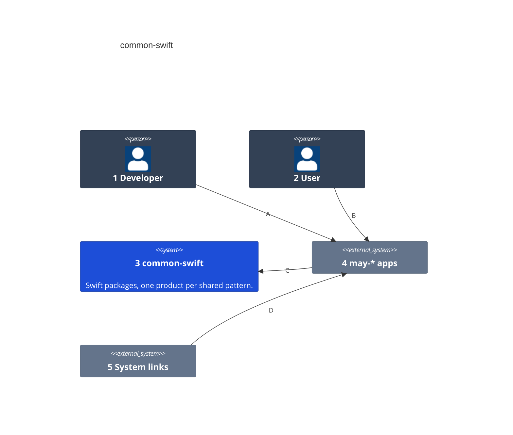
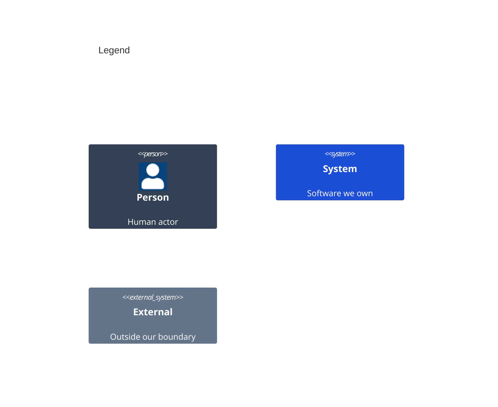

# System Context

Numbers on nodes and letters on arrows match the callout table.

| #   | Description | Why |
| --- | --- | --- |
| 1   | Builds a may-* app and links the products it needs. | Each app keeps its own routes and screens. |
| 2   | Moves between screens, opens links and writes drafts. | The packages serve what the user does. |
| 3   | This repository: one Swift package with one library product per pattern. | A pattern is written once, not once per app. |
| 4   | may-calendar, may-journals and may-photos. | They grew the patterns the packages keep. |
| 5   | Share links, widget taps and handoff, delivered through `onOpenURL`. | A link can arrive before the app is ready. |
| A   | Defines the app's routes and binds its stacks. | The app owns what its screens are. |
| B   | Taps, swipes and opens links. | Every move goes through one router. |
| C   | Links only the products it imports. | An app pays only for what it uses. |
| D   | Opens the app at a link. | The app parses it through a table. |
