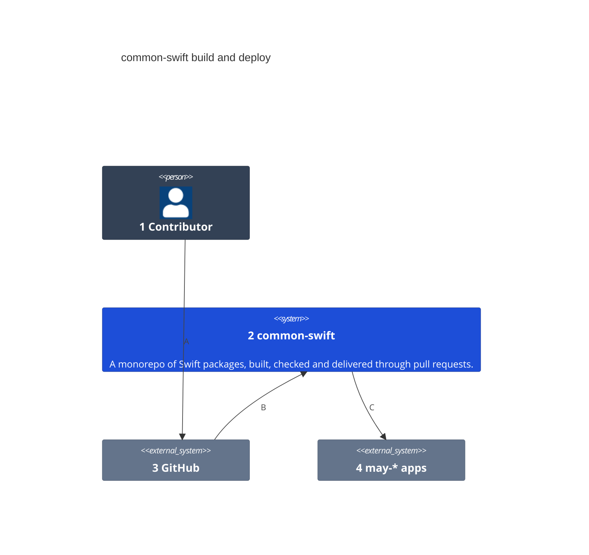
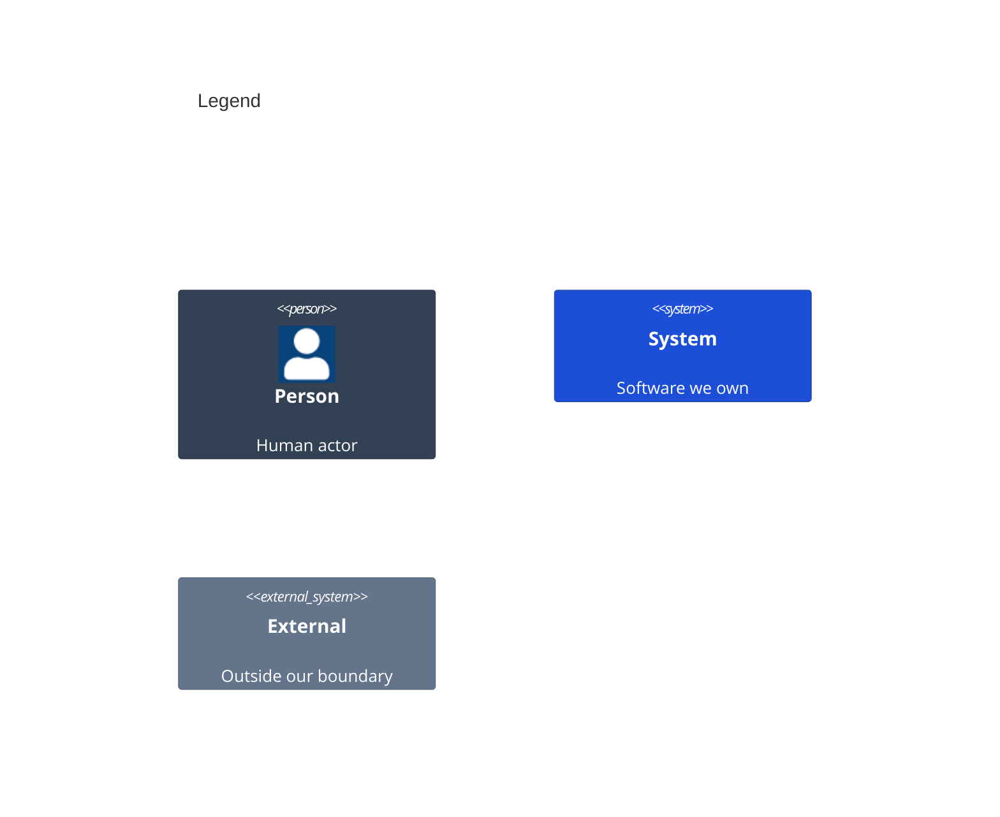

# System Context

How common-swift is built, checked and delivered.

Numbers on nodes and letters on arrows match the callout table.

| #   | Description | Why |
| --- | --- | --- |
| 1   | A developer or an agent who changes the repo. | Every change arrives as a pull request. |
| 2   | This repository: separate Swift packages with one build and delivery flow. | The flow is written once for every package. |
| 3   | Hosts the repo, runs the pull request flow and the checks. | Nothing merges without its checks. |
| 4   | The may-* apps that depend on the packages. | The apps receive packages, never source copies. |
| A   | Opens a pull request. | Work is reviewed before it reaches main. |
| B   | Starts the build, the tests and the fitness checks. | Each change is proved in CI. |
| C   | Delivers the packages as Swift packages. | An app takes a package through its manifest. |
