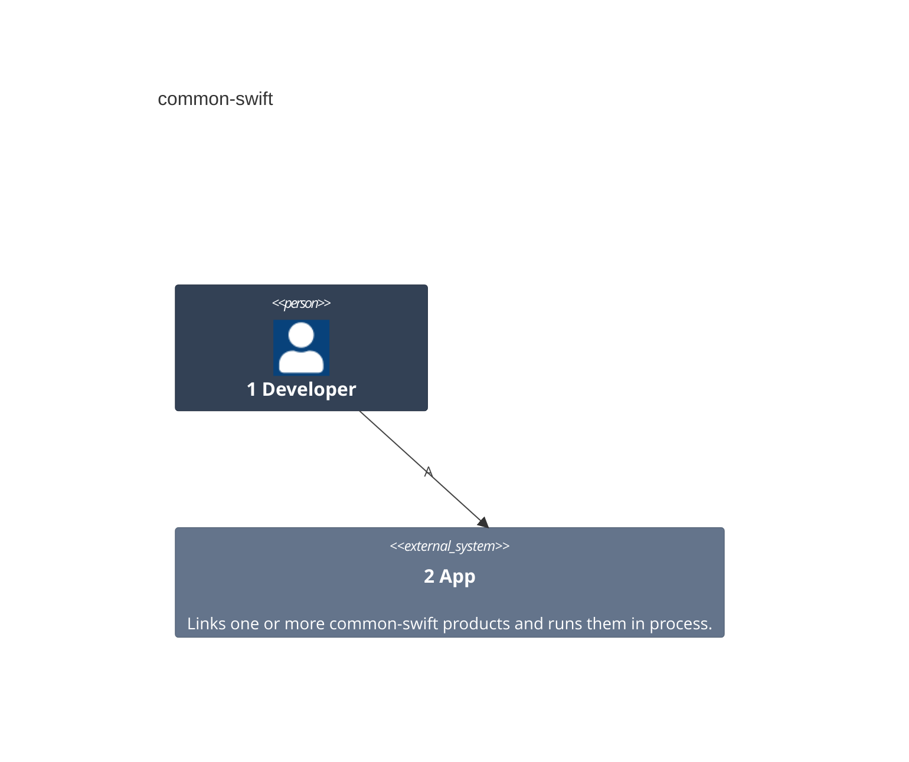
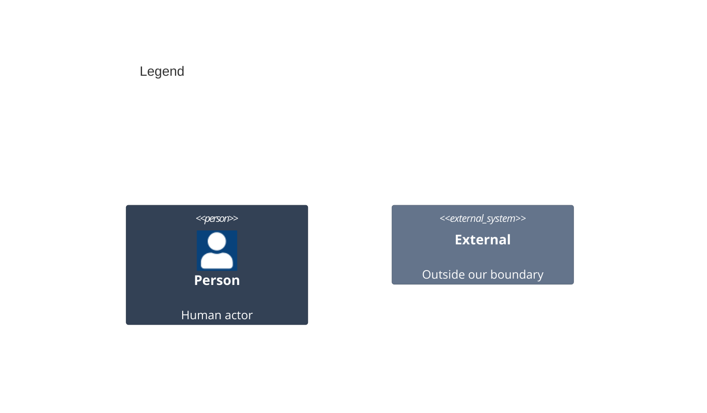

# Containers

A container here is a unit that runs on its own. Each package is a library that runs inside the app, so it adds no container; [03-components.md](03-components.md) shows the packages.

Numbers on nodes and letters on arrows match the callout table.

| #   | Description | Why |
| --- | --- | --- |
| 1   | The developer from the system context. | They add a product to an app. |
| 2   | The app process each linked library runs in. | A library is no runnable unit of its own. |
| A   | The developer builds and runs the app. | The packages are dependencies, not tools. |
