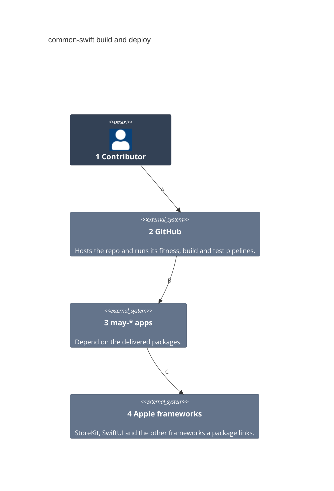
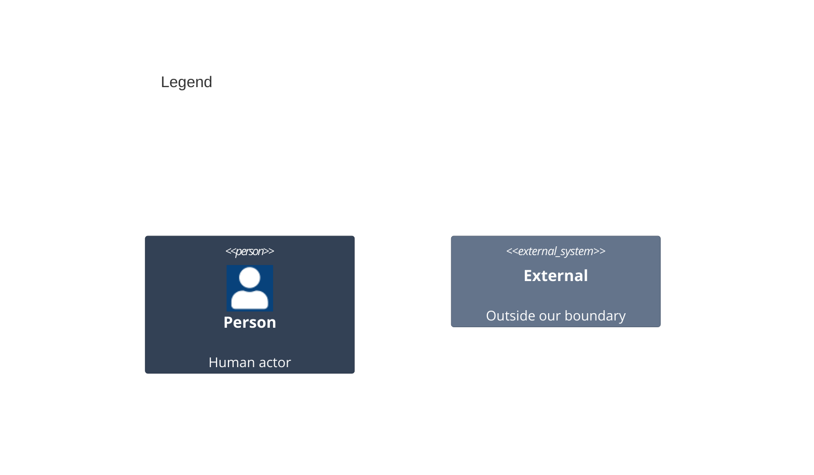

# Containers

A container here is a unit that runs on its own. The repo ships only libraries, so it adds none; GitHub's pipelines build, check and deliver them.

Numbers on nodes and letters on arrows match the callout table.

| #   | Description | Why |
| --- | --- | --- |
| 1   | The contributor from the system context. | They push a change to a branch. |
| 2   | Runs the fitness checks, the package build and tests, and the release. | The repo keeps no server of its own. |
| 3   | The apps that receive the delivered packages. | They update a package by its version. |
| 4   | The system frameworks the packages import. | They ship with the OS, not with the repo. |
| A   | Pushes the branch and opens a pull request. | Review comes before main. |
| B   | Delivers each package as a Swift package. | The app takes it through its manifest. |
| C   | Links the frameworks the packages name. | A package adds no framework the app did not choose. |

Release Please runs in manifest mode with only the root `.` component, so one `vX.Y.Z` tag versions every package. SwiftPM reads versions only from repo-wide tags of a root manifest, and the `release-changelog` check binds the root version to `version.txt`. So may-journal/.github syncs its shared release template here unchanged.
