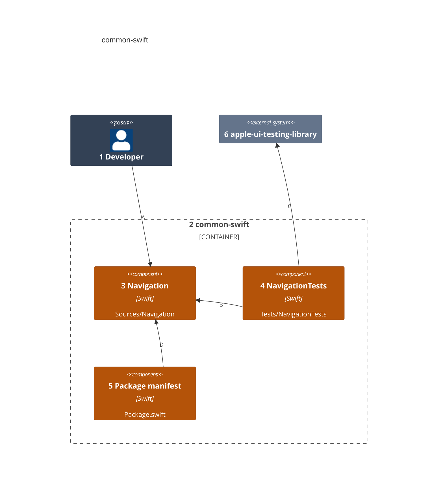
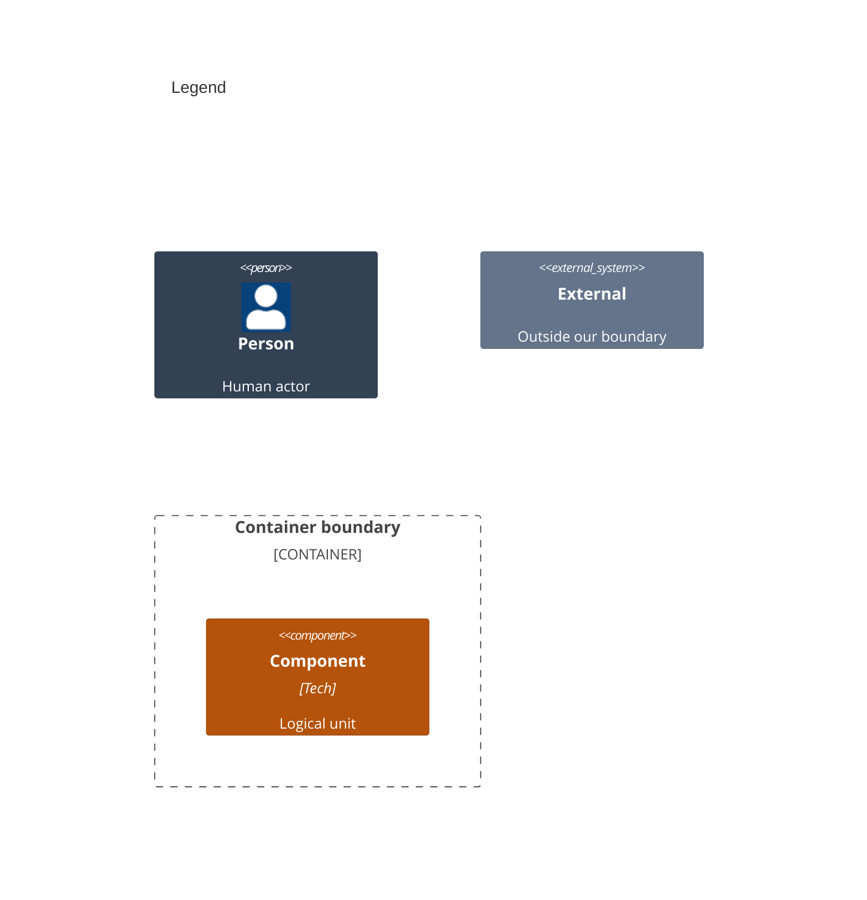

# Components

This splits the libraries in [02-containers.md](02-containers.md) into packages. Each package is one target behind one product, so an app imports it alone.

Numbers on nodes and letters on arrows match the callout table.

| #   | Description | Why |
| --- | --- | --- |
| 1   | The developer who imports a package. | Each app picks its products. |
| 2   | The repository's one Swift package. | One manifest keeps versions in step. |
| 3   | The `Navigation` product: router, link table, held requests and leave guard. | The apps each grew these on their own. |
| 4   | Requirement tests that render an example app. | Each acceptance has one test. |
| 5   | `Package.swift`, which names each product and the platforms. | It states Swift 6, iOS 27 and macOS 27. |
| 6   | Renders a screen and acts as a person would. | Tests drive the package the way an app uses it. |
| A   | Imports `Navigation` and binds a stack. | The app keeps its own routes. |
| B   | Drives the package through an example app. | Tests use only the public surface. |
| C   | Renders the example app and taps it. | Test targets only; apps never ship it. |
| D   | Builds the library from its sources. | One product per target. |
