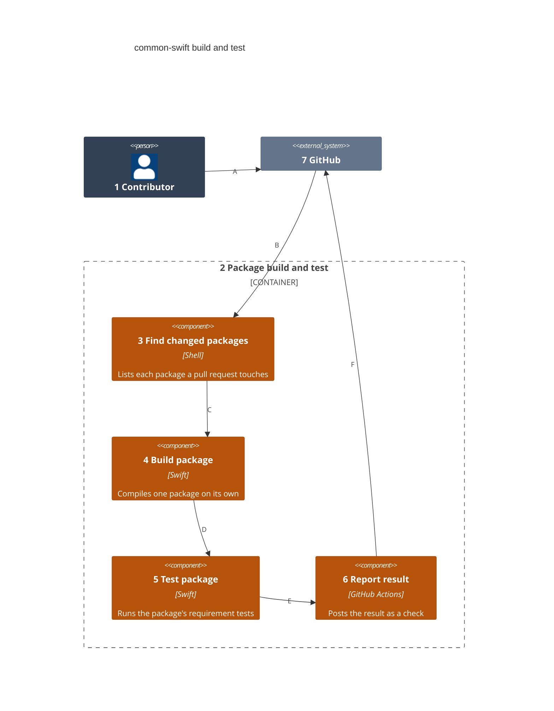
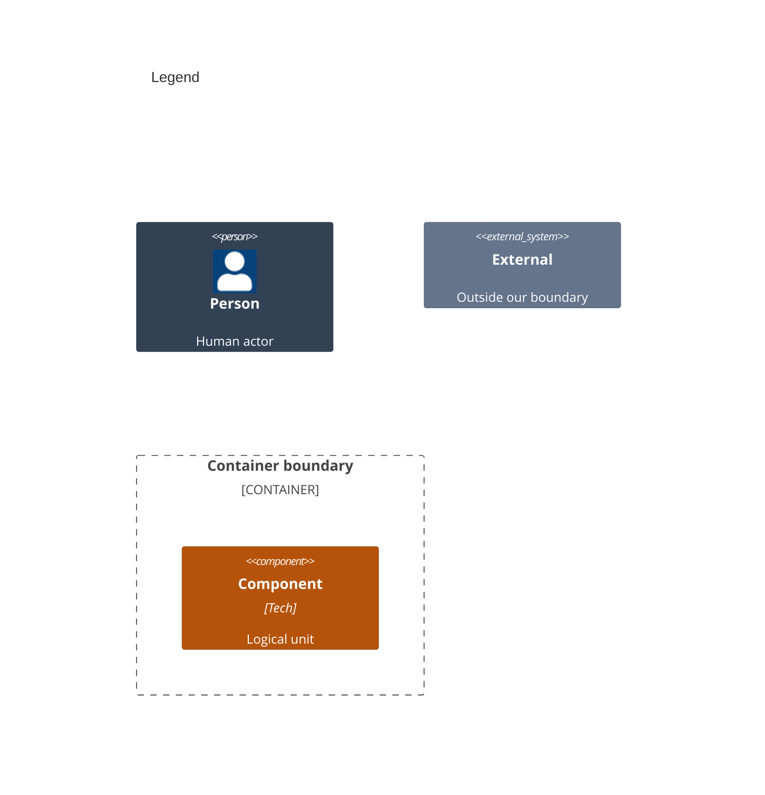

# Components

This splits the pipelines in [02-containers.md](02-containers.md) into the build and test steps. They run for every package alike.

Numbers on nodes and letters on arrows match the callout table.

| #   | Description | Why |
| --- | --- | --- |
| 1   | The person whose push starts the steps. | The steps need no manual start. |
| 2   | The container that proves each package. | One flow for every package. |
| 3   | Lists the packages a pull request touches. | Only changed packages rebuild. |
| 4   | Compiles a package from its own manifest. | A package builds alone. |
| 5   | Runs the package's tests. | A package proves its own requirements. |
| 6   | Posts the result as a check. | The result gates the merge. |
| 7   | Hosts the pull request and the checks. | It is the one door for every change. |
| A   | Pushes the change to a pull request. | The push starts the flow. |
| B   | Starts the workflow. | No manual build step. |
| C   | Hands over the package list. | Each package is built in turn. |
| D   | Hands over the built package. | Tests run on what was built. |
| E   | Hands over the test result. | The check reflects the tests. |
| F   | Posts the check. | Reviewers see one result. |
