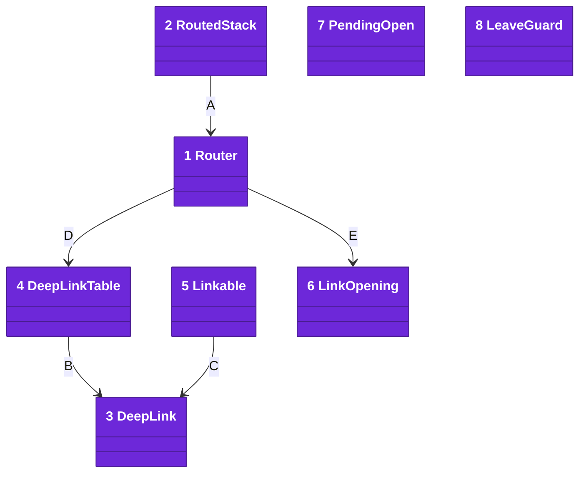
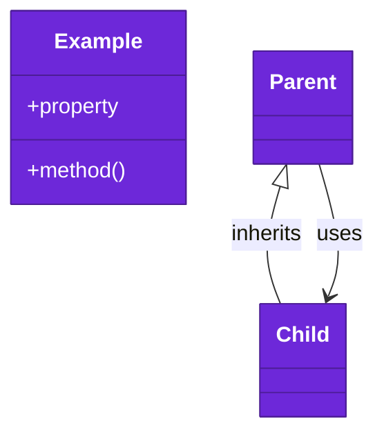

# Code

The `Navigation` target lives under `Sources/Navigation/`. It imports Foundation, Observation and SwiftUI.

Numbers on classes and letters on relationships match the callout table. See [02-containers.md](02-containers.md) and [03-components.md](03-components.md).

| #   | Description | Why |
| --- | --- | --- |
| 1   | [`Router`](../../Sources/Navigation/Router.swift) owns a stack's path: `push`, `show`, `pop`, `popToRoot` and `reset`. | The path outlives any redraw. |
| 2   | [`RoutedStack`](../../Sources/Navigation/RoutedStack.swift) binds a navigation stack to a router, with one destination. | The destination sits at the root. |
| 3   | [`DeepLink`](../../Sources/Navigation/DeepLink.swift) is a link's host, path and query. | Parsing and printing share one shape. |
| 4   | [`DeepLinkTable`](../../Sources/Navigation/DeepLinkTable.swift) maps each host to a small parser. | No parser grows into one long switch. |
| 5   | [`Linkable`](../../Sources/Navigation/DeepLinkTable.swift) is a route that prints its own link. | Share links and incoming links agree. |
| 6   | [`LinkOpening`](../../Sources/Navigation/LinkOpening.swift) says a link opened, named gone content, or was not ours. | The app shows "Not Found" rather than a blank screen. |
| 7   | [`PendingOpen`](../../Sources/Navigation/PendingOpen.swift) holds a request until the screen takes it once. | A cold launch hears links early. |
| 8   | [`LeaveGuard`](../../Sources/Navigation/LeaveGuard.swift) parks an exit while work is unsaved. | Every exit asks before it drops a draft. |
| A   | `RoutedStack` binds to the router's path. | Views never own the path. |
| B   | `DeepLinkTable` reads a `DeepLink` from a URL. | Each parser sees host, path and query. |
| C   | A `Linkable` route prints a `DeepLink`. | One format both ways. |
| D   | `Router.open` reads a URL through a table. | One door for every link. |
| E   | `Router.open` returns a `LinkOpening`. | The caller decides how to say "Not Found". |

## Platforms

iOS 27 and macOS 27 and later, matching the apps' deployment targets, built with Swift tools 6.0 in the Swift 6 language mode.

## Tests

`swift test` runs every requirement test on the Mac. Each test owns one acceptance in [docs/requirements](../requirements/) and renders an example app with [apple-ui-testing-library](https://github.com/may-journal/apple-ui-testing-library).
