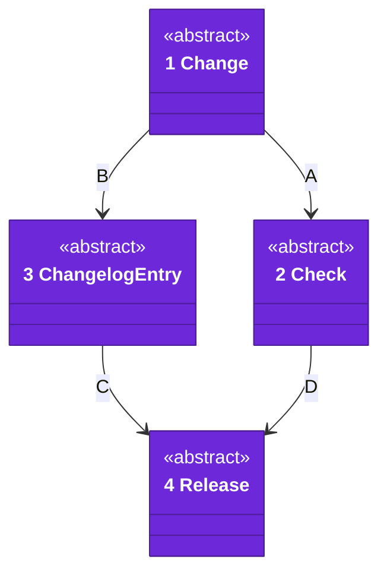
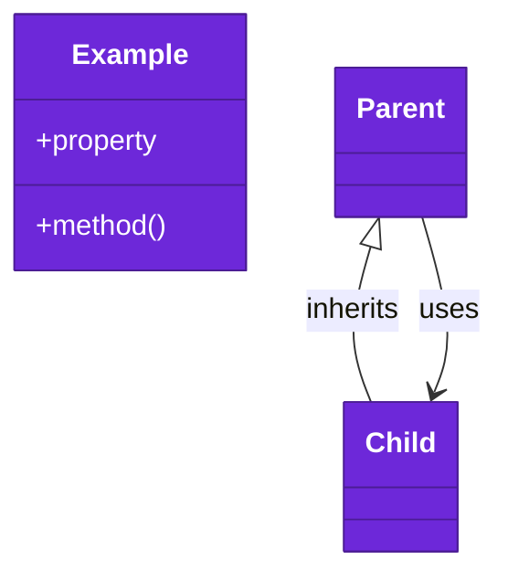

# Code

No build code lives here yet. This view shows the build and delivery flow as types; each package draws its own classes in its own architecture docs.

Numbers on classes and letters on relationships match the callout table. See [02-containers.md](02-containers.md) and [03-components.md](03-components.md).

| #   | Description | Why |
| --- | --- | --- |
| 1   | A pull request that changes the repo. | Every change takes the same path. |
| 2   | A fitness, build or test check on the change. | Checks judge the change, not the person. |
| 3   | The changelog entry file a change adds. | Each change records itself once. |
| 4   | A version delivered to the apps. | An app updates by version. |
| A   | The change is judged by its checks. | Red checks stop it. |
| B   | The change adds its entry. | The entry feeds the release. |
| C   | The entry names what a release holds. | The release notes come from entries. |
| D   | Green checks allow the release. | Nothing red is delivered. |

## Tests

Each package runs `swift test` in its own folder, so a package proves its requirements alone.
