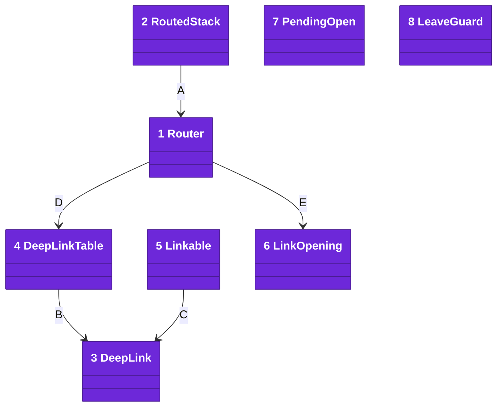
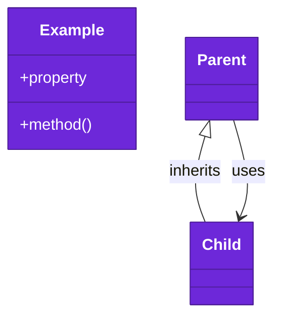
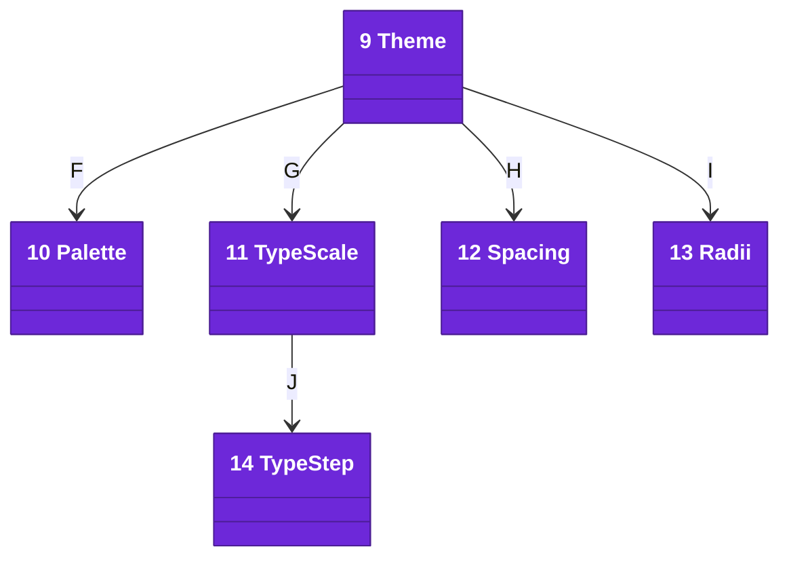
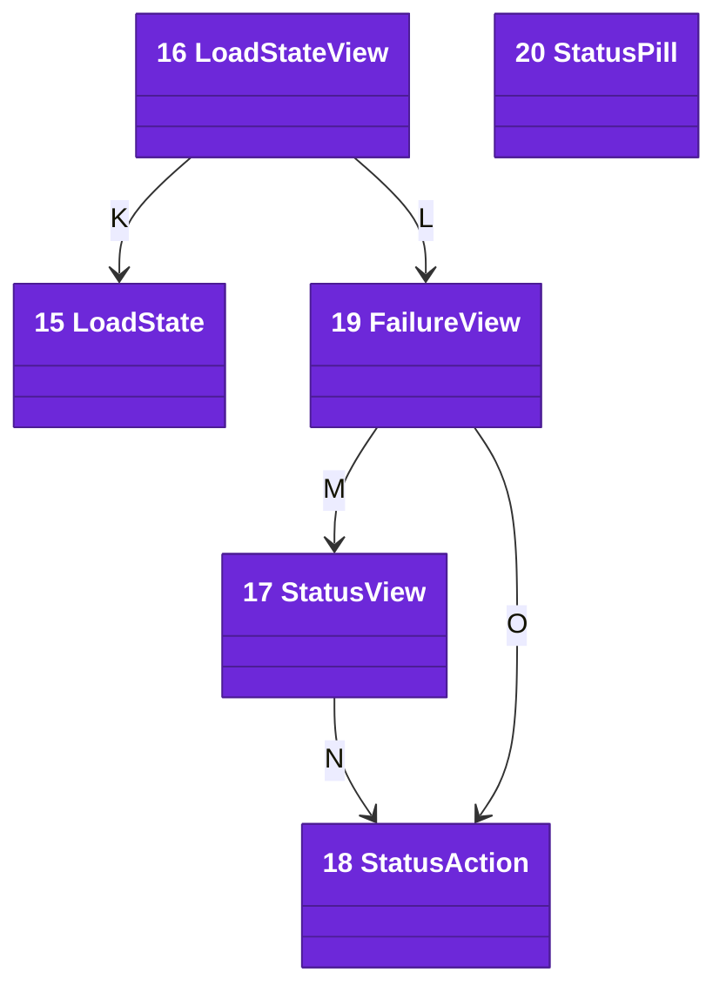
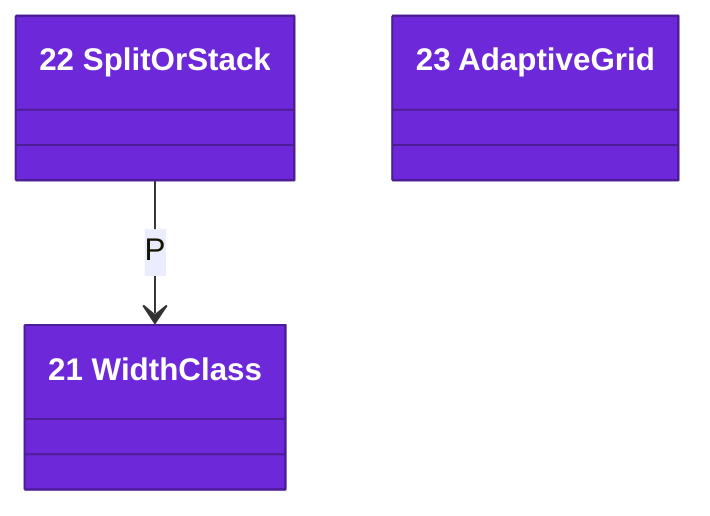

# Code

The `Navigation` target lives under `Sources/Navigation/`. It imports Foundation, Observation and SwiftUI.

Numbers on classes and letters on relationships match the callout table. See [02-containers.md](02-containers.md) and [03-components.md](03-components.md).

| #   | Description | Why |
| --- | --- | --- |
| 1   | [`Router`](../../Sources/Navigation/Router.swift) owns a stack's path: `push`, `show`, `pop`, `popToRoot` and `reset`. | The path outlives any redraw. |
| 2   | [`RoutedStack`](../../Sources/Navigation/RoutedStack.swift) binds a navigation stack to a router, with one destination. | The destination sits at the root. |
| 3   | [`DeepLink`](../../Sources/Navigation/DeepLink.swift) is a link's host, path and query. | Parsing and printing share one shape. |
| 4   | [`DeepLinkTable`](../../Sources/Navigation/DeepLinkTable.swift) maps each host to a small parser. | No parser grows into one long switch. |
| 5   | [`Linkable`](../../Sources/Navigation/DeepLinkTable.swift) is a route that prints its own link. | Share links and incoming links agree. |
| 6   | [`LinkOpening`](../../Sources/Navigation/LinkOpening.swift) says a link opened, named gone content, or was not ours. | The app shows "Not Found" rather than a blank screen. |
| 7   | [`PendingOpen`](../../Sources/Navigation/PendingOpen.swift) holds a request until the screen takes it once. | A cold launch hears links early. |
| 8   | [`LeaveGuard`](../../Sources/Navigation/LeaveGuard.swift) parks an exit while work is unsaved. | Every exit asks before it drops a draft. |
| A   | `RoutedStack` binds to the router's path. | Views never own the path. |
| B   | `DeepLinkTable` reads a `DeepLink` from a URL. | Each parser sees host, path and query. |
| C   | A `Linkable` route prints a `DeepLink`. | One format both ways. |
| D   | `Router.resolve` reads a URL through a table; `open` also shows it. | One door for every link. |
| E   | `Router.resolve` returns a `LinkOpening`. | The caller decides how to say "Not Found". |

## Theme

The `Theme` target lives under `Sources/Theme/`. It imports SwiftUI, and UIKit or AppKit for colors that follow the appearance.

| #   | Description | Why |
| --- | --- | --- |
| 9   | [`Theme`](../../Sources/Theme/Theme.swift) is the app's tokens, read from the environment. | Shared views never name app colors. |
| 10  | [`Palette`](../../Sources/Theme/Palette.swift) is ten color roles, standard from system colors. | Apps fill it with `Color(light:dark:)` or `Color(hex:)` from [Color+Hex](../../Sources/Theme/Color+Hex.swift). |
| 11  | [`TypeScale`](../../Sources/Theme/TypeScale.swift) is four steps that grow with text size. | No view types a point size. |
| 12  | [`Spacing`](../../Sources/Theme/Metrics.swift) is the spacing scale, margins and readable width. | Layout reads one set of sizes. |
| 13  | [`Radii`](../../Sources/Theme/Metrics.swift) is the corner radii. | Every card rounds alike. |
| 14  | [`TypeStep`](../../Sources/Theme/TypeScale.swift) is one size and the text style it grows with. | A Mac draws it at one size. |
| F   | A theme holds its palette. | Roles, not names. |
| G   | A theme holds its type scale. | One scale per app. |
| H   | A theme holds its spacing. | One set of sizes per app. |
| I   | A theme holds its radii. | One set of corners per app. |
| J   | Each step of the scale is a `TypeStep`. | Apps set sizes, styles follow. |

## ScreenStates

The `ScreenStates` target lives under `Sources/ScreenStates/`. It imports SwiftUI and `Theme`.

| #   | Description | Why |
| --- | --- | --- |
| 15  | [`LoadState`](../../Sources/ScreenStates/LoadState.swift) is loading, failed with a message, or loaded. | One value says where data stands. |
| 16  | [`LoadStateView`](../../Sources/ScreenStates/LoadStateView.swift) switches a screen over its load state. | Each screen stops writing the switch. |
| 17  | [`StatusView`](../../Sources/ScreenStates/StatusView.swift) is a symbol tile, title, message and button. | Empty and failed screens share it. |
| 18  | [`StatusAction`](../../Sources/ScreenStates/StatusView.swift) is the button's title and what it runs. | An empty screen offers a way on. |
| 19  | [`FailureView`](../../Sources/ScreenStates/StatusView.swift) shows a failure with Try Again. | A failure is never a dead end. |
| 20  | [`StatusPill`](../../Sources/ScreenStates/StatusPill.swift) is a spinner and a label in a capsule. | A slow task shows it runs. Its sibling, [`loadingPlaceholder`](../../Sources/ScreenStates/Placeholder.swift), redacts sample content. |
| K   | The view reads the state it shows. | The model owns the state. |
| L   | A failed state shows the failure. | Try Again calls the caller's retry. |
| M   | A failure is a status with a warning symbol. | One layout for both. |
| N   | A status may carry one action. | At most one button. |
| O   | A failure builds its Try Again action. | Retry runs the caller's closure. |

## AdaptiveLayout

The `AdaptiveLayout` target lives under `Sources/AdaptiveLayout/`. It imports SwiftUI and `Theme`; `readableColumn` and `card` are view modifiers in [ReadableColumn](../../Sources/AdaptiveLayout/ReadableColumn.swift).

| #   | Description | Why |
| --- | --- | --- |
| 21  | [`WidthClass`](../../Sources/AdaptiveLayout/WidthClass.swift) is narrow or wide, from a measured width. | A Mac window has no size class. |
| 22  | [`SplitOrStack`](../../Sources/AdaptiveLayout/SplitOrStack.swift) shows two panes when wide and pushes when narrow. | The apps each wrote this switch. |
| 23  | [`AdaptiveGrid`](../../Sources/AdaptiveLayout/AdaptiveGrid.swift) fills rows with tiles no narrower than a minimum. | Gaps come from the theme. |
| P   | The split picks its layout by width class. | It waits for the width before pushing. |

## Platforms

iOS 27 and macOS 27 and later, matching the apps' deployment targets, built with Swift tools 6.0 in the Swift 6 language mode.

## Tests

`swift test` runs every requirement test on the Mac. Each test owns one acceptance in [docs/requirements](../requirements/) and renders an example app with [apple-ui-testing-library](https://github.com/may-journal/apple-ui-testing-library).
