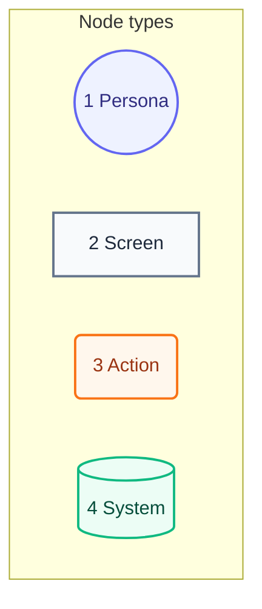
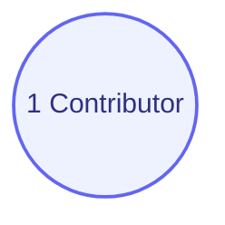

# User Journey

## Legend

Numbers match the callout table.

| #   | Description | Why                                      |
| --- | ----------- | ---------------------------------------- |
| 1   | Persona     | A person the system context declares.    |
| 2   | Screen      | What the person sees.                    |
| 3   | Action      | What the person does.                    |
| 4   | System      | What the product does in reply.          |

## Journey

No package behavior exists yet, so no step names a requirement. Each package adds its steps with its first requirement.

Numbers match the callout table.

| #   | Description | Type | Why |
| --- | --- | --- | --- |
| 1   | A developer or an agent who changes the repo. | Persona | Same person as the system context. |
