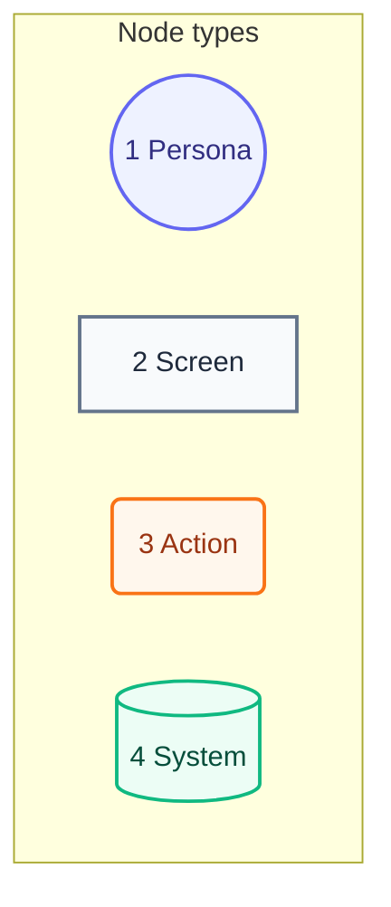
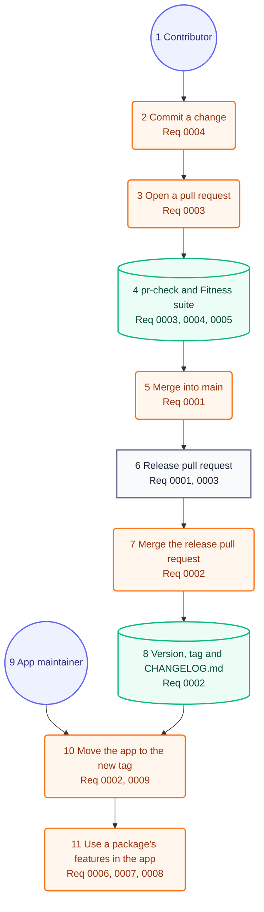

# User Journey

## Legend

Numbers match the callout table.

| #   | Description | Why                                      |
| --- | ----------- | ---------------------------------------- |
| 1   | Persona     | A person the system context declares.    |
| 2   | Screen      | What the person sees.                    |
| 3   | Action      | What the person does.                    |
| 4   | System      | What the product does in reply.          |

## Journey

The root journey runs from a commit to an app update. Each package adds its own steps with its first requirement.

Numbers match the callout table.

| #   | Description | Type | Why |
| --- | --- | --- | --- |
| 1   | A developer or an agent who changes the repo. | Persona | Same person as the system context. |
| 2   | Commits with a conventional subject and a `changelog/` entry. | Action | The commit hook refuses a red commit. |
| 3   | Opens a pull request with a conventional title that links the entry. | Action | pr-check reads the title and the link. |
| 4   | pr-check, then the Fitness suite with the tests, run on the pull request. | System | A red check blocks the merge. |
| 5   | Merges the green pull request into main. | Action | The push starts only Release Please. |
| 6   | Release Please opens or updates the one release pull request. | Screen | It passes pr-check with no entry file. |
| 7   | Merges the release pull request. | Action | This is the one step that releases. |
| 8   | Release Please writes the version, the `vX.Y.Z` tag and `CHANGELOG.md`. | System | No other workflow writes them. |
| 9   | A developer who keeps a may-* app current. | Persona | Same person as the system context. |
| 10  | Moves the app's dependency on the repo URL to the new tag. | Action | The app takes the release by version, with only the products it picks. |
| 11  | Uses what a package promises; its own journey draws the steps. | Action | Fitness reads every requirement doc here only. |
