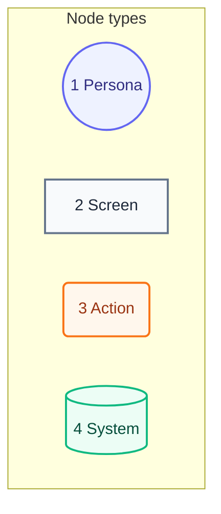
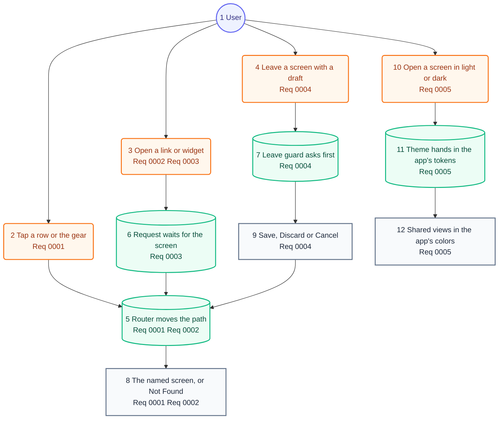

# User Journey

## Legend

Numbers match the callout table.

| #   | Description | Why                                      |
| --- | ----------- | ---------------------------------------- |
| 1   | Persona     | A person the system context declares.    |
| 2   | Screen      | What the person sees.                    |
| 3   | Action      | What the person does.                    |
| 4   | System      | What the product does in reply.          |

## Journey

Numbers match the callout table.

| #   | Description | Type | Why |
| --- | --- | --- | --- |
| 1   | The person using a may-* app. | Persona | Same person as the system context. |
| 2   | Pushes a screen, or brings Settings to the front. | Action | A screen never opens twice. |
| 3   | Arrives through `onOpenURL`, maybe on a cold launch. | Action | Links from outside land like taps. |
| 4   | Taps Back, another row, or a link while editing. | Action | Any exit can drop a draft. |
| 5   | Pushes, pops or brings a route to the front. | System | One path, owned by a model. |
| 6   | Holds the request until the data loads. | System | The screen takes it once. |
| 7   | Parks the exit while work is unsaved. | System | One gate for every exit. |
| 8   | Shows the route, or "Not Found" for gone content. | Screen | Never a blank screen. |
| 9   | Asks before leaving unsaved work. | Screen | Save leaves only once it lands. |
| 10  | Opens any screen, in the appearance they chose. | Action | Colors follow light and dark. |
| 11  | Reads the theme the app set at its root, or the standard one. | System | No shared view names app colors. |
| 12  | Draws in the app's colors, spacing and radii. | Screen | Shared views look native to each app. |
